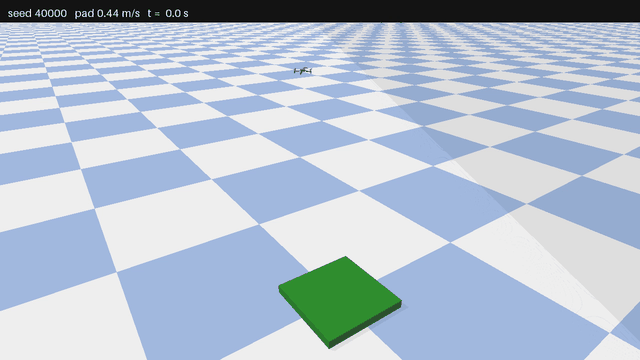

# Drone Landing on a Moving Platform

A simulated quadcopter learns to land on a moving platform with reinforcement learning (PPO), and is
compared with a hand-tuned PID controller under identical conditions: same observation, same action interface,
same safety layer, same seeds.

<p align="center">
  
</p>
<p align="center"><em>The final stage-2 agent (run 8) landing on a pad moving at 0.34 m/s: 0.06 m/s touchdown, 1.3 cm from the centre.</em></p>

## Results

A landing counts as successful when the touchdown speed is below 0.5 m/s and the drone is within 10 cm of the pad
centre. Policies are deterministic. Settings (PID gains, agent checkpoints) are chosen on validation seeds 500-599 only;
test seeds are fresh and run once.

### Stage 2: pad moving in a straight line at 0.2-0.5 m/s (final)

10,000 test episodes per controller. The agent is run 8, trained with three seeds (30,000 episodes in total,
seeds 40000-59999); the PID was run on seeds 40000-49999.

| Controller | Failures | Touchdown speed (median / max) | Offset from centre (median / max) | Time to land (median) | Max tilt |
|------------|----------|--------------------------------|-----------------------------------|-----------------------|----------|
| PPO (run 8, 3 seeds) | **0 / 30,000** | **0.06** / 0.37 m/s | **0.9** / 7.3 cm | **2.4 s** | 20 deg |
| PID baseline | 0 / 10,000 | 0.14 / **0.19** m/s | 1.5 / **5.4** cm | 6.9 s | 21 deg |

The agent is as safe as the PID, lands softer and more precisely in the typical case, and is about 3x faster.
The PID still has the tighter worst case (max touchdown speed and offset).

### Stage 1: static pad

100 test episodes (seeds 1000-1099): PPO 100% (touchdown 0.18 m/s, offset 2.9 cm, 2.7 s), PID 100%
(0.15 m/s, 1.6 cm, 8.8 s).

### Stage 3: vehicle at 4-30 km/h that speeds up and brakes (in progress)

The pad is now a vehicle driving at 4-8.33 m/s (up to 30 km/h), changing speed at 1-2 m/s², with air drag. The drone starts
already flying along with it. On validation seeds, the PID (re-tuned for this stage) lands 91% in 10.5 s. The best
agent so far lands 77% in 3.8 s, and misses mostly by landing more than 10 cm off-centre. Work in progress, see the roadmap.

### What made the difference

Each change was tested in its own training run, one change at a time:

1. **Own velocity in the observation.** With only relative velocity, the agent can't tell its own motion from the pad's,
   so it trails behind like a P-only controller.
2. **Rate limiter on the velocity command (0.08 m/s per step).** The agent's commands were bang-bang. The inner
   velocity loop lagged behind them, and about 1% of episodes ended in loss of control (up to 3 m/s and 66 deg tilt).
   Limiting how fast the command may change removed these failures (78 / 10,000 -> 0 / 10,000). It also made
   exploration safe, so PPO stopped "hovering forever" much sooner.
3. **Safety margin in training.** The agent trains against stricter limits (0.35 m/s, 7 cm) than the test
   (0.5 m/s, 10 cm), like a safety factor in engineering.
4. **Graded landing reward.** A flat landing bonus pays a 7 cm landing the same as a perfect one. Grading it on the
   offset (run 7a) and then also on the touchdown speed (run 8) gave the precision and the soft touchdowns. It also
   removed a rare tail of hard landings that showed up on one of the 7a seeds.

### Findings

- With the same information, a well-tuned PID solves the constant-speed pad perfectly; the agent matches it on safety
  and is faster. The case for RL is in the harder stages (changing speeds, noise, wind).
- Success rates near 100% need large tests: 0 failures in 100 episodes only shows a failure rate below ~3%.
  The final claims use 10,000 episodes per controller.
- Results that look perfect on one training seed may not replicate: run 7a had 0 failures on seed 0 but 7 on seed 2.
  The final stage-2 agent was therefore confirmed on three seeds.
- At 30 km/h the action had to change. With an absolute velocity command and a 10 m/s speed limit, exploration noise
  was ±3 m/s, and the agent learned to fly along without ever descending. Commanding a correction on top of the
  vehicle's velocity, which is how real flight stacks layer guidance and control, broke that trap.

## How it works

The environment, `LandingAviary`, extends `BaseRLAviary` from
[gym-pybullet-drones](https://github.com/utiasDSL/gym-pybullet-drones) (PyBullet physics, Crazyflie 2.x model).

- **Observation (18 values; 21 in stage 3):**
  - position and velocity relative to the pad;
  - roll / pitch / yaw and angular velocity;
  - the drone's own velocity;
  - the velocity command currently applied (after the rate limiter);
  - in stage 3, the vehicle's acceleration, broadcast as by a cooperative vehicle with a datalink.

  No absolute world coordinates.
- **Action:** a target velocity, tracked by the library's built-in controller at 30 Hz, through a rate limiter of
  0.08 m/s per step (2.4 m/s²). In stage 3 the action is a correction of up to 2 m/s on top of the vehicle's velocity.
- **Reward:** potential-based progress towards the pad, a small time penalty, a landing bonus that drops linearly with
  offset and touchdown speed, a mild penalty for a bad landing (-20) and a large one for a crash (-100). Each term is
  logged separately.
- **Episode end:** landed, bad landing, crashed, or out of bounds (terminated), or the 15 s time limit (truncated).
- **PID baseline:** a PID loop on the relative position that outputs the same velocity action. It uses the pad
  velocity as feedforward, which is the same information the agent has, and goes through the same rate limiter. Gains
  are tuned on the validation seeds.
- **Training:** PPO (Stable-Baselines3 defaults), 8 parallel environments, 5M steps. Checkpoints from 2.5M to 5M are
  scored on the validation seeds. The rule: highest success, ties go to the lowest median touchdown speed.

## Usage

```bash
uv sync
uv run train.py --preset stage2 --run-name my_run          # run 8's recipe; flags override the preset
uv run evaluate.py --model results/my_run/checkpoints/model_3000000_steps.zip --seed 40000 --episodes 10000 --workers 12
uv run evaluate.py --pid --own-velocity-obs --action-rate-limit 0.08 --pad-speed 0.2 0.5 --seed 40000 --episodes 10000 --workers 12
uv run record_video.py --model results/my_run/model.zip --seeds 40000 40001
uv run compare_video.py --left results/my_run/model.zip --right pid --labels PPO PID --seeds 40000 --out results/compare/demo.mp4
```

`evaluate.py` reads the task and observation settings from the run's `config.json`, so a model is always evaluated
on what it was trained on.

## Project structure

```
envs/landing_aviary.py   Custom environment: pad / vehicle, observation, reward, termination, rate limiter
train.py                 PPO training (presets stage2 / stage3), TensorBoard outcome and touchdown logging
evaluate.py              Fixed-seed evaluation (agent or PID), per-episode CSV, parallel workers
pid_baseline.py          PID controller baseline
pid_sweep.py, pid_tune.py  PID speed-success sweep (stage 2) and gain tuning (stage 3) on validation seeds
record_video.py          Headless video with a follow camera, can replay episodes by outcome from an eval CSV
compare_video.py         Two controllers side by side on the same seeds
notebooks/               Analysis of training logs and evaluation CSVs
results/                 Models, logs, CSVs and videos (git-ignored)
```

## Roadmap

- [x] Landing on a static pad
- [x] PID baseline on the same seeds
- [x] Pad moving in a straight line at constant speed (as safe as the PID, softer, more precise and 3x faster)
- [ ] Fast vehicle (up to 30 km/h) that speeds up and brakes (in progress)
- [ ] Turns / random paths
- [ ] Wind and sensor noise (delay and noise on the vehicle's broadcast)
- [ ] Stretch: tilting deck, camera-only landing

## License

[MIT](LICENSE)
