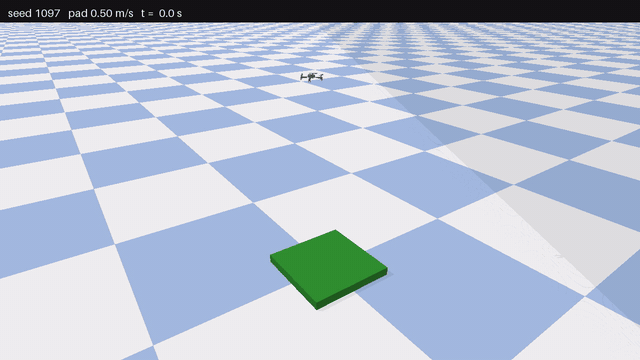

# Drone Landing on a Moving Platform

A simulated quadcopter learns to land on a moving platform with reinforcement learning (PPO), and is
compared with a hand-tuned PID controller under identical conditions.

<p align="center">
  
</p>
<p align="center"><em>PPO agent landing on a pad moving at 0.5 m/s in a random direction.</em></p>

## Results

Evaluated on 100 fixed-seed episodes (seeds 1000-1099) with a deterministic policy.
A landing counts as successful when touchdown speed is below 0.5 m/s and the drone is within 10 cm of the pad centre.

Touchdown speed and offset are over all episodes that touched the pad, successful or not.

| Stage | Controller | Success | Touchdown speed (median / max) | Offset from centre (median / max) | Time to land (median) |
|-------|------------|---------|--------------------------------|-----------------------------------|-----------------------|
| Static pad | PPO, 1M steps | 100% | 0.18 / 0.35 m/s | 2.9 / 8.4 cm | 2.7 s |
| Static pad | PID baseline | 100% | 0.15 / 0.20 m/s | 1.6 / 4.5 cm | 8.8 s |
| Moving pad, 0.2-0.5 m/s | PPO, 5M steps | 90% | 0.34 / 0.70 m/s | 5.2 / 11.3 cm | 2.0 s |
| Moving pad, 0.2-0.5 m/s | PID baseline | 100% | 0.15 / 0.19 m/s | 1.5 / 4.1 cm | 9.1 s |

Findings so far:
- The PID baseline is slower but more precise. Its integral term is what makes it work on the moving pad:
  with only P it trails behind the pad and never lines up well enough to descend (0% success).
- The agent trained on a static pad lands 0% on the moving pad; the agent trained on the moving pad still lands
  95% on a static pad.
- PPO gets stuck hovering above the pad for a long time before it learns to land (about 2M steps on the moving pad),
  and a higher discount factor (gamma 0.995) did not shorten this.
- The agent's success drops with pad speed (96% at 0.2-0.3 m/s, 82% at 0.4-0.5 m/s). Its observation has no memory
  and only relative velocity, so it can't tell its own velocity apart from the pad's.

## How it works

The environment, `LandingAviary`, extends `BaseRLAviary` from
[gym-pybullet-drones](https://github.com/utiasDSL/gym-pybullet-drones) (PyBullet physics, Crazyflie 2.x model).

- **Observation (12 values):** position and velocity relative to the pad, roll/pitch/yaw, angular velocity.
  No absolute world coordinates, so the policy learns to close the gap rather than memorise a location.
- **Action:** a target velocity (capped at 1.0 m/s), tracked by the library's built-in PID at 30 Hz.
- **Reward:** potential-based progress towards the pad, a small per-step time penalty, a large bonus for a
  soft centred landing, and penalties for bad landings and crashes. Each term is logged separately.
- **Episode end:** landed, bad landing, crashed, or out of bounds (terminated), or the 15 s time limit (truncated).
- **Start state:** random, up to 1 m horizontally from the pad and 1-1.5 m high.
- **Moving pad:** each episode the pad drives in a straight line in a random direction at a random constant speed
  (0.2-0.5 m/s for the moving-pad stage).
- **PID baseline:** a PID loop on the relative position that outputs the same velocity action as the agent and sees
  the same observation, so both are compared on decision making only. Both run through the same evaluation loop on
  the same seeds. Its gains were tuned on separate validation seeds (500-599).

## Project structure

```
envs/landing_aviary.py   Custom environment: pad, observation, reward, termination
train.py                 PPO training
evaluate.py              Fixed-seed evaluation, per-episode CSV
record_video.py          Headless video recording with a follow camera, can pick episodes by outcome from an eval CSV
pid_baseline.py          PID controller baseline
notebooks/               Analysis of training logs and evaluation CSVs
results/                 Models, logs and CSVs (git-ignored)
```

## Roadmap

- [x] Landing on a static pad
- [x] PID baseline on the same seeds
- [x] Pad moving in a straight line at constant speed
- [ ] Random paths and changing speeds
- [ ] Wind and sensor noise
- [ ] Stretch: curved paths, tilting deck, camera-only landing

## License

[MIT](LICENSE)
