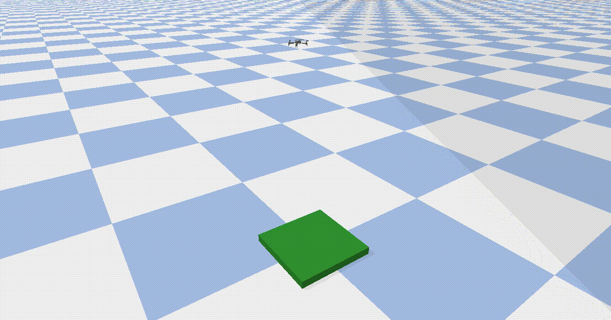

# Drone Landing on a Moving Platform

A simulated quadcopter learns to land on a moving platform with reinforcement learning (PPO), and is
compared with a hand-tuned PID controller under identical conditions.

<!-- Demo: add once the moving-pad agent works.
<p align="center">
  
</p>
-->

## Results

Evaluated on 100 fixed-seed episodes (seeds 1000-1099) with a deterministic policy.
A landing counts as successful when touchdown speed is below 0.5 m/s and the drone is within 10 cm of the pad centre.

| Stage | Controller | Success | Touchdown speed (median / max) | Offset from centre (median / max) |
|-------|------------|---------|--------------------------------|-----------------------------------|
| Static pad | PPO, 1M steps | 100% | 0.18 / 0.35 m/s | 2.9 / 8.4 cm |
| Static pad | PID baseline | in progress | | |
| Moving pad, straight line | PPO | in progress | | |

## How it works

The environment, `LandingAviary`, extends `BaseRLAviary` from
[gym-pybullet-drones](https://github.com/utiasDSL/gym-pybullet-drones) (PyBullet physics, Crazyflie 2.x model).

- **Observation (12 values):** position and velocity relative to the pad, roll/pitch/yaw, angular velocity.
  No absolute world coordinates, so the policy learns to close the gap rather than memorise a location.
- **Action:** a target velocity (capped at 1.0 m/s), tracked by the library's built-in PID at 30 Hz.
- **Reward:** potential-based progress towards the pad, a small per-step time penalty, a large bonus for a
  soft centred landing, and penalties for bad landings and crashes. Each term is logged separately.
- **Episode end:** landed, bad landing, crashed, or out of bounds (terminated), or the 15 s time limit (truncated).
- **Start state:** random, up to 1 m horizontally from the pad and 1-1.5 m high.

## Project structure

```
envs/landing_aviary.py   Custom environment: pad, observation, reward, termination
train.py                 PPO training
evaluate.py              Fixed-seed evaluation, per-episode CSV
record_video.py          Headless video recording with a follow camera
pid_baseline.py          PID controller baseline (in progress)
notebooks/               Analysis of training logs and evaluation CSVs
results/                 Models, logs and CSVs (git-ignored)
```

## Roadmap

- [x] Landing on a static pad
- [ ] PID baseline on the same seeds
- [ ] Pad moving in a straight line at constant speed
- [ ] Random paths and changing speeds
- [ ] Wind and sensor noise
- [ ] Stretch: curved paths, tilting deck, camera-only landing

## License

[MIT](LICENSE)
